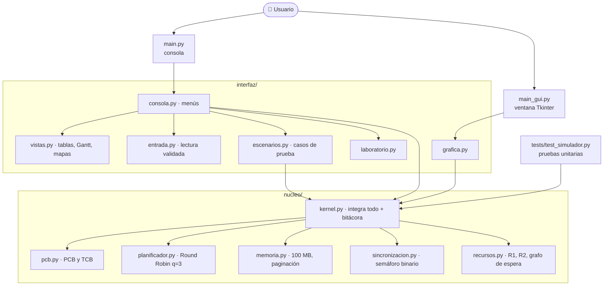
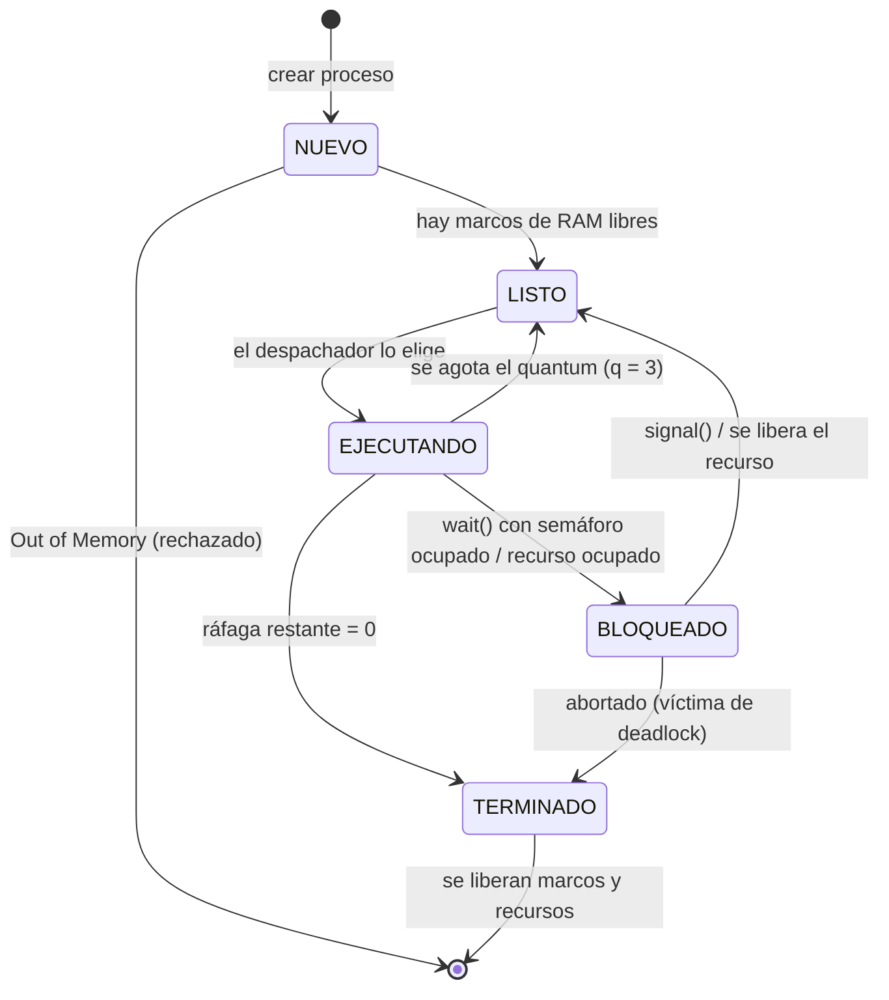

<div align="center">

# 🖥️ Simulador de Funciones del Kernel

**Simulador educativo del núcleo de un sistema operativo, escrito en Python puro**

[](https://www.python.org/)
[](#-requisitos)
[](#-pruebas-automáticas)
[](#-cómo-ejecutarlo)

[](#)
[](#)
[](#)
[](#-aviso-educativo)
[](#-requisitos)

</div>

---

## 📚 Aviso educativo

> [!IMPORTANT]
> Este proyecto se desarrolló **con fines exclusivamente educativos** para el curso de **Sistemas Operativos I** de la **Universidad Mariano Gálvez de Guatemala**.
> **No es un sistema operativo real** ni interactúa con el kernel de su computadora: todo (procesos, CPU, memoria, semáforos y recursos) se simula dentro de un programa de Python para que se pueda **ver, paso a paso, cómo toma decisiones un kernel**.

---

## 📑 Tabla de contenido

1. [¿Qué es este proyecto?](#-qué-es-este-proyecto)
2. [Integrantes y responsabilidades](#-integrantes-y-responsabilidades)
3. [Características](#-características)
4. [Requisitos](#-requisitos)
5. [Instalación](#-instalación)
6. [Cómo ejecutarlo](#-cómo-ejecutarlo)
7. [Guía de uso del menú](#-guía-de-uso-del-menú)
8. [¿Cómo funciona por dentro?](#-cómo-funciona-por-dentro)
9. [Estructura del proyecto](#-estructura-del-proyecto)
10. [Cumplimiento de los requerimientos](#-cumplimiento-de-los-requerimientos)
11. [Casos de prueba del informe](#-casos-de-prueba-del-informe)
12. [Pruebas automáticas](#-pruebas-automáticas)
13. [Decisiones de diseño](#-decisiones-de-diseño)
14. [Límites y validaciones](#-límites-y-validaciones)
15. [Solución de problemas](#-solución-de-problemas)

---

## 🎯 ¿Qué es este proyecto?

Es un simulador, por línea de comandos y con una ventana gráfica opcional, que reproduce el comportamiento **lógico** de las funciones principales del núcleo de un sistema operativo:

| Función del kernel | Lo que se simula |
|---|---|
| 🧩 **Gestión de procesos** | Creación de procesos con su **PCB** (bloque de control de proceso) y sus hilos con **TCB** (bloque de control de hilo). |
| ⏱️ **Planificación de CPU** | Algoritmo **Round Robin con quantum q = 3**, con cambio de contexto, cola de listos y diagrama de Gantt. |
| 💾 **Gestión de memoria** | **RAM de 100 MB** con **paginación simple** (25 marcos de 4 MB) y rechazo por **Out of Memory**. |
| 🔒 **Concurrencia** | **Sección crítica** protegida por un **semáforo binario** con `wait()` / `signal()` y cola de espera FIFO. |
| ☠️ **Interbloqueo** | Recursos **R1** y **R2**, deadlock forzado, **detección con grafo de espera** y recuperación abortando una víctima. |

La idea es que el estudiante pueda crear procesos, ejecutar la CPU un quantum a la vez y observar en tablas, mapas de memoria y bitácoras **qué hace el kernel y por qué**.

---

## 👥 Integrantes y responsabilidades

| Integrante | Área | Archivos a su cargo |
|---|---|---|
| **Allen Josef Espino Hartogh** | 🧠 **Núcleo (kernel)** — lógica de procesos, planificación, memoria, sincronización y deadlock | `nucleo/` |
| **Gabriela Elízabeth Noemí Aguilar Vásquez** | 🎨 **Interfaz** — menús de consola, vistas, colores, entrada validada, escenarios, laboratorio e interfaz gráfica | `interfaz/` |
| **Oliver Fernando Romero Esquite** | 🧪 **Pruebas y puntos de entrada** — pruebas unitarias, `main.py`, `main_gui.py` y documentación | `tests/`, `main.py`, `main_gui.py`, `README.md` |

---

## ✨ Características

- ✅ **Sin dependencias externas**: solo la biblioteca estándar de Python.
- ✅ **Dos interfaces sobre el mismo núcleo**: consola (entrega oficial) y ventana gráfica con Tkinter (apoyo visual para la demostración). Ninguna duplica lógica: ambas llaman al mismo `Kernel`.
- ✅ **Bitácora de eventos** con marca de tiempo simulada (`t=…`) y niveles `OK`, `ERROR`, `ALERTA`, `CPU`, `CTX`, `INFO`; se puede exportar a `.txt`.
- ✅ **Diagrama de Gantt** y **métricas**: tiempo de espera, retorno, respuesta, throughput y cambios de contexto.
- ✅ **Mapa de memoria** que muestra qué página de qué proceso ocupa cada marco.
- ✅ **Grafo de espera** para visualizar el ciclo de un deadlock.
- ✅ **4 casos de prueba** listos para el informe, que no alteran la simulación del usuario.
- ✅ **Modo Laboratorio**: predecir el orden de Round Robin, comparar distintos quantums y experimentar con la paginación.
- ✅ **A prueba de errores de entrada**: letras, decimales, negativos, vacíos, números gigantes o `Ctrl+C` nunca detienen el programa.
- ✅ **14 pruebas unitarias** que verifican memoria, planificación, semáforo y deadlock.

---

## 🧰 Requisitos

| Requisito | Detalle |
|---|---|
| Python | **3.10 o superior** (probado con 3.13) |
| Librerías externas | **Ninguna** |
| Interfaz gráfica (opcional) | **Tkinter**, que ya viene con Python en Windows y macOS. En Linux puede requerir `sudo apt install python3-tk`. |
| Terminal recomendada | **Windows Terminal** o la terminal de VS Code, para ver colores y bordes de tablas. |

Verifique su versión de Python:

```bash
python --version      # o en Windows: py --version
```

---

## 📥 Instalación

```bash
git clone https://github.com/AllenEH/simulador-kernel.git
cd simulador-kernel
```

No hay que instalar nada más: no hay `requirements.txt` porque no se usan librerías externas.

---

## ▶️ Cómo ejecutarlo

| Comando | Qué hace |
|---|---|
| `python main.py` | Abre el **menú interactivo** de consola (entrega oficial). |
| `python main.py --casos` | Ejecuta los **4 casos de prueba** del informe y termina. |
| `python main.py --exportar` | Ejecuta los 4 casos y los guarda en `casos_de_prueba_AAAAMMDD_HHMMSS.txt`. |
| `python main_gui.py` | Abre la **interfaz gráfica** (Tkinter). |
| `python -m unittest -v` | Corre las **14 pruebas automáticas**. |

> [!TIP]
> En Windows, si `python` no se reconoce, use `py` en su lugar: `py main.py`.

---

## 🧭 Guía de uso del menú

Al ejecutar `python main.py` aparece el menú principal:

```
SIMULADOR DE FUNCIONES DEL KERNEL
 1. Gestión de procesos (PCB / TCB)
 2. Planificación Round Robin (q = 3)
 3. Gestión de memoria (100 MB, paginación)
 4. Concurrencia: semáforo y sección crítica
 5. Interbloqueo (Deadlock)
 6. Casos de prueba para el informe
 7. Bitácora de eventos
 8. Reiniciar simulador
 9. Modo Laboratorio (ejemplos manipulables)
 0. Salir
```

<details>
<summary><b>1 · Gestión de procesos (PCB / TCB)</b></summary>

- Crear un proceso indicando nombre, tamaño en MB, ráfaga de CPU y número de hilos.
- Crear varios procesos aleatorios de una sola vez.
- Agregar un hilo (TCB) a un proceso existente (máximo 8 por proceso).
- Ver la tabla de procesos (PCB), la tabla de hilos (TCB) y el detalle de un proceso.
- Abortar un proceso (libera su memoria y sus recursos).
</details>

<details>
<summary><b>2 · Planificación Round Robin (q = 3)</b></summary>

- Ejecutar **un quantum** (paso a paso) o ejecutar hasta vaciar la cola de listos.
- Ver la cola de listos en orden.
- Ver el **diagrama de Gantt** y las **métricas** de rendimiento.
- Comparar con el **cálculo teórico** de tiempos de espera.
</details>

<details>
<summary><b>3 · Gestión de memoria</b></summary>

- **Mapa de memoria**: los 25 marcos y qué página de qué proceso hay en cada uno.
- **Tabla de páginas** de un proceso (página lógica → marco físico).
- Crear un proceso y observar si entra o es rechazado por falta de RAM.
</details>

<details>
<summary><b>4 · Concurrencia: semáforo y sección crítica</b></summary>

- `wait()`: un proceso pide entrar a la sección crítica. Si está ocupada, queda **BLOQUEADO** en la cola del semáforo.
- Modificar la variable global compartida (solo el dueño del semáforo puede hacerlo).
- `signal()`: el proceso sale y la sección crítica pasa al primero de la cola.
- Simular una **condición de carrera** sin semáforo y con semáforo para comparar resultados.
</details>

<details>
<summary><b>5 · Interbloqueo (Deadlock)</b></summary>

- **Forzar deadlock**: el proceso A retiene R1 y pide R2; el proceso B retiene R2 y pide R1.
- Solicitar y liberar recursos manualmente.
- **Detectar** el ciclo en el grafo de espera.
- **Abortar** un proceso víctima para romper el ciclo.
</details>

<details>
<summary><b>6 · Casos de prueba · 7 · Bitácora · 9 · Laboratorio</b></summary>

- **6**: ejecuta los 4 casos del informe por separado o todos juntos y los exporta a `.txt`.
- **7**: muestra la bitácora de la sesión actual y permite exportarla (`bitacora_*.txt`).
- **9 · Modo Laboratorio**:
  - *Predicción Round Robin*: el usuario adivina qué proceso usa la CPU en cada turno.
  - *Comparador de quantums*: las mismas ráfagas con distintos `q`, para ver por qué se eligió `q = 3`.
  - *Laboratorio de memoria*: crear y terminar procesos para ver cómo se reparten las páginas.
</details>

### 🪟 Interfaz gráfica

`python main_gui.py` abre una ventana con las pestañas **Procesos · Round Robin · Memoria · Semáforo · Deadlock · Bitácora**. Cada proceso tiene su propio color, y se puede ejecutar la CPU en **modo automático** para ver el Gantt y el mapa de memoria actualizarse solos. Usa exactamente el mismo núcleo que la consola.

---

## ⚙️ ¿Cómo funciona por dentro?

### Arquitectura en capas

El proyecto separa **la lógica** (núcleo, sin `print` ni `input`) de **la presentación** (interfaz). Así el mismo núcleo sirve para la consola, la ventana gráfica y las pruebas.



### Ciclo de vida de un proceso



### 1. Procesos: PCB y TCB (`nucleo/pcb.py`)

Cada proceso tiene un **PCB** que guarda: PID, nombre, estado, tamaño en MB, ráfaga total y restante, contador de programa, tiempo de llegada y de fin, marcos asignados, hilos y recursos retenidos. Cada hilo tiene un **TCB** con su TID, el PID del proceso padre, su estado y su contador de programa. Un proceso puede tener de 1 a 8 hilos.

### 2. Planificación Round Robin (`nucleo/planificador.py`)

1. Los procesos en estado **LISTO** esperan en una cola FIFO.
2. El despachador toma el primero y le da la CPU hasta **3 unidades de tiempo** (el quantum).
3. Si termina antes, pasa a **TERMINADO** y se libera su memoria.
4. Si se le acaba el quantum, ocurre un **cambio de contexto**: se guarda su estado en el PCB (ráfaga restante y contador de programa) y vuelve **al final** de la cola.
5. Cada turno se agrega al **diagrama de Gantt** para calcular las métricas.

### 3. Memoria con paginación simple (`nucleo/memoria.py`)

- La RAM de **100 MB** se divide en **25 marcos de 4 MB**.
- Un proceso de *T* MB necesita ⌈*T* / 4⌉ páginas. Por ejemplo, 30 MB → 8 páginas.
- Las páginas se colocan en **cualquier** marco libre, aunque no estén juntos.
- Si no hay marcos suficientes, el proceso se **rechaza** con un mensaje de *Out of Memory* y no se crea.
- Al terminar o abortar un proceso, sus marcos vuelven a estar libres.

### 4. Semáforo binario (`nucleo/sincronizacion.py`)

- `wait()`: si el semáforo está libre, el proceso entra a la sección crítica; si está ocupado, el proceso pasa a **BLOQUEADO**, sale de la cola de listos y entra a la cola del semáforo.
- `signal()`: solo el dueño puede llamarlo. La sección crítica se entrega directamente al **primero de la cola** (FIFO), así nadie espera para siempre.
- La simulación de **condición de carrera** muestra cómo, sin semáforo, se pierden actualizaciones de la variable compartida y, con semáforo, el resultado es exacto.

### 5. Deadlock (`nucleo/recursos.py` + `kernel.py`)

- Hay dos recursos, **R1** y **R2**, que solo puede retener un proceso a la vez.
- Cada vez que una solicitud bloquea a un proceso, el kernel construye el **grafo de espera** (quién espera a quién) y busca un **ciclo** con una búsqueda en profundidad (DFS).
- Si encuentra un ciclo, emite una **ALERTA** de deadlock. El usuario elige una víctima y la **aborta**: sus recursos pasan al siguiente proceso en espera y el ciclo se rompe.

---

## 🗂️ Estructura del proyecto

```
simulador-kernel/
├── main.py                    Punto de entrada de la consola (y opciones --casos / --exportar)
├── main_gui.py                Punto de entrada de la interfaz gráfica
├── README.md                  Este documento
├── .gitignore
│
├── nucleo/                    🧠 Lógica del kernel (sin entrada/salida)
│   ├── __init__.py            Expone Kernel, Estado y ErrorKernel
│   ├── pcb.py                 PCB, TCB y estados del proceso
│   ├── planificador.py        Round Robin: cola de listos, quantum, cambio de contexto, Gantt
│   ├── memoria.py             RAM de 100 MB, marcos, tablas de páginas, Out of Memory
│   ├── sincronizacion.py      Semáforo binario wait()/signal() y condición de carrera
│   ├── recursos.py            Recursos R1/R2, grafo de espera y detección de ciclos
│   └── kernel.py              Integra todos los módulos y registra la bitácora
│
├── interfaz/                  🎨 Presentación
│   ├── consola.py             Menús de texto
│   ├── entrada.py             Lectura validada de datos (prueba de estrés)
│   ├── vistas.py              Tablas, mapa de memoria, Gantt, grafo de espera
│   ├── escenarios.py          4 casos de prueba y cálculo teórico de RR
│   ├── laboratorio.py         Modo Laboratorio
│   ├── grafica.py             Ventana Tkinter
│   └── colores.py             Colores ANSI para la terminal
│
└── tests/                     🧪 Pruebas
    ├── __init__.py
    └── test_simulador.py      14 pruebas unitarias
```

---

## ✅ Cumplimiento de los requerimientos

| Requerimiento del enunciado | Implementación |
|---|---|
| **PCB** con PID, estado, tamaño, ráfaga total y restante | `nucleo/pcb.py` → clase `PCB`; además guarda llegada, fin, marcos, hilos y recursos. |
| **TCB** | `nucleo/pcb.py` → clase `TCB` (TID, PID padre, estado, contador de programa). |
| **Round Robin q = 3** con cambio de contexto | `nucleo/planificador.py`. Al agotar el quantum se guarda el estado en el PCB y el proceso vuelve al final de la cola. |
| **RAM de 100 MB** y rechazo por **Out of Memory** | `nucleo/memoria.py`. 25 marcos de 4 MB; si no hay marcos suficientes, el proceso no se crea. |
| **Sección crítica** y **semáforo binario** con cola de espera | `nucleo/sincronizacion.py`. El proceso bloqueado sale de la cola de listos. |
| **Recursos R1 y R2**, deadlock forzado, detección y aborto | `nucleo/recursos.py`, `Kernel.forzar_deadlock()` y `Kernel.abortar()`. |
| **Interfaz por menús de texto** | `interfaz/consola.py`. |
| **Prueba de estrés** con datos inválidos | `interfaz/entrada.py`: ningún dato inválido detiene el programa. |
| **Evidencia / bitácora** | Menú 6 y 7, `python main.py --exportar`. |

---

## 🧾 Casos de prueba del informe

Se ejecutan con el menú **6** o con `python main.py --casos`. Cada caso usa un kernel nuevo, así que **no altera** la simulación del usuario.

### Caso 1 · Rechazo por falta de RAM (Out of Memory)

| Proceso | Tamaño | Páginas | Resultado |
|---|---|---|---|
| Navegador | 40 MB | 10 | ✅ Entra (quedan 60 MB) |
| Editor | 40 MB | 10 | ✅ Entra (quedan 20 MB = 5 marcos) |
| Compilador | 30 MB | 8 | ❌ Rechazado: necesita 8 marcos y solo hay 5 |
| Terminal | 20 MB | 5 | ✅ Entra: la RAM queda al 100 % |
| Reloj | 1 MB | 1 | ❌ Rechazado: 0 marcos libres |
| BaseDatos | 150 MB | 38 | ❌ Rechazado: es mayor que toda la RAM |

### Caso 2 · Sucesión de ráfagas en Round Robin (q = 3)

Ráfagas: **P1 = 7, P2 = 4, P3 = 9, P4 = 2** (todos llegan en t = 0).

```
|  P1  |  P2  |  P3  | P4 |  P1  | P2 |  P3  | P1 |  P3  |
0      3      6      9   11     14   15     18   19     22
```

| PID | Ráfaga | Fin | Retorno | Espera | Respuesta |
|---|---|---|---|---|---|
| P1 | 7 | 19 | 19 | 12 | 0 |
| P2 | 4 | 15 | 15 | 11 | 3 |
| P3 | 9 | 22 | 22 | 13 | 6 |
| P4 | 2 | 11 | 11 | 9 | 9 |
| **Promedio** | | | **16.75** | **11.25** | **4.50** |

Cambios de contexto totales: **5** · Throughput: **0.182 procesos/unidad de tiempo**.

### Caso 3 · Semáforo vs. condición de carrera

Sin semáforo, varios procesos leen y escriben la variable global al mismo tiempo y se **pierden actualizaciones**. Con el semáforo binario, solo uno entra a la vez a la sección crítica y el resultado final es **exacto**.

### Caso 4 · Deadlock

El proceso A retiene **R1** y pide **R2**; el proceso B retiene **R2** y pide **R1**. El kernel detecta el ciclo `A → B → A` en el grafo de espera, se **aborta A**, R1 pasa a B y **B termina** normalmente.

---

## 🧪 Pruebas automáticas

```bash
python -m unittest -v
```

Las pruebas usan `unittest` (incluido en Python) y comprueban directamente el núcleo:

| Área | Qué se verifica |
|---|---|
| 💾 **Memoria** | Se rechaza un proceso sin RAM suficiente · se rechaza un proceso mayor que toda la RAM · llenado exacto y liberación de marcos · la memoria se libera al terminar el proceso. |
| ⏱️ **Round Robin** | Orden de ejecución y tiempos esperados · ningún turno excede el quantum de 3 · validación de datos de entrada. |
| 🔒 **Semáforo** | La condición de carrera pierde actualizaciones y el semáforo las evita · la cola de espera es FIFO · un proceso bloqueado sale de la cola de listos · no se permite `signal()` a quien no es dueño. |
| ☠️ **Deadlock** | Detección del ciclo y su resolución abortando una víctima · no se puede forzar un deadlock con recursos ocupados · un proceso bloqueado no puede solicitar otro recurso. |

Resultado esperado:

```
Ran 14 tests in 0.00Xs

OK
```

---

## 🧠 Decisiones de diseño

**Paginación simple.** Elimina la fragmentación externa: un proceso puede ocupar marcos no contiguos, por lo que nunca se rechaza un proceso que sí cabe en la memoria libre total. El costo es una fragmentación interna de hasta 3 MB en la última página.

**Round Robin con q = 3.** Es apropiativo y equitativo: ningún proceso acapara la CPU y el tiempo máximo antes de recibir CPU es `(n − 1) × q`. Un quantum pequeño favorece la interactividad a cambio de más cambios de contexto (el Modo Laboratorio permite comparar).

**Semáforo binario con cola FIFO.** El proceso bloqueado no consume CPU (no hay espera activa) y el orden FIFO evita la inanición.

**Deadlock: detección y recuperación.** En lugar de prevenir el interbloqueo, se permite que ocurra para poder estudiarlo, se detecta con el grafo de espera y se recupera abortando una víctima.

**Núcleo sin entrada/salida.** `nucleo/` nunca usa `print` ni `input`; registra todo en una bitácora. Esto permite probarlo con pruebas unitarias y reutilizarlo en la consola y en la ventana gráfica.

---

## 🛡️ Límites y validaciones

| Parámetro | Rango permitido |
|---|---|
| Tamaño de un proceso | 1 – 100 000 MB (los mayores a 100 MB se rechazan por Out of Memory) |
| Ráfaga de CPU | 1 – 1000 unidades |
| Hilos por proceso | 1 – 8 |
| Nombre del proceso | hasta 20 caracteres (opcional) |
| Quantum | 3 (fijo) |
| RAM | 100 MB = 25 marcos de 4 MB |
| Recursos | R1 y R2 |

Cualquier dato fuera de rango, con letras, decimales o negativo se rechaza con un mensaje y se vuelve a pedir. Dejar la entrada vacía o presionar `Ctrl+C` cancela la acción actual sin cerrar el simulador.

---

## 🩺 Solución de problemas

| Problema | Solución |
|---|---|
| `python` no se reconoce (Windows) | Use `py main.py` o agregue Python al PATH al instalarlo. |
| `Se requiere Python 3.10 o superior.` | Actualice Python desde [python.org](https://www.python.org/downloads/). |
| Se ven símbolos raros en lugar de colores o bordes | Use Windows Terminal o la terminal de VS Code. |
| `ModuleNotFoundError: No module named 'tkinter'` (Linux) | `sudo apt install python3-tk` |
| `ModuleNotFoundError: No module named 'nucleo'` o `'interfaz'` | Ejecute los comandos **desde la carpeta raíz** del proyecto (donde está `main.py`). |

---

<div align="center">

**Universidad Mariano Gálvez de Guatemala · Sistemas Operativos I · 2026**

Proyecto con fines educativos 📚

</div>
